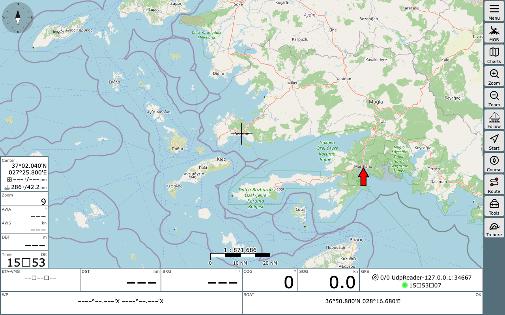
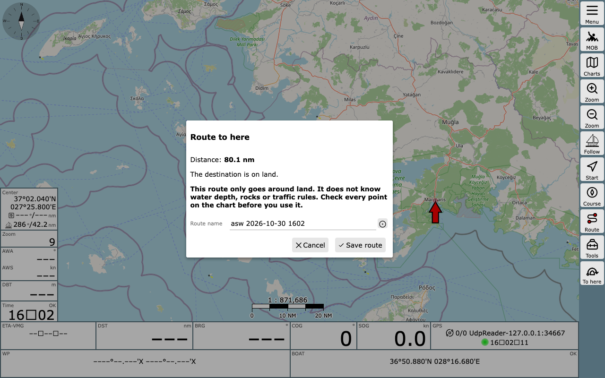
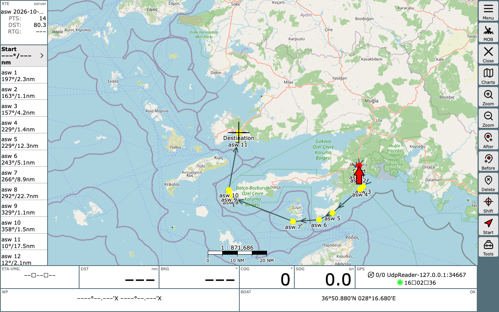

# AvNav plugin for auto-sea-way

This plugin adds a "Route to here" button to the chart page of [AvNav](https://github.com/wellenvogel/avnav). Put the crosshair on your destination and press the button. The plugin asks [auto-sea-way](https://github.com/auto-sea-way/asw) (asw) for a route over water from the boat to the crosshair that goes around land, shows the distance, and saves the route after you have read a warning. asw runs on the same device as AvNav, so it works without internet at sea. Internet is needed once, to download the map data.

The idea comes from [avnav#435](https://github.com/wellenvogel/avnav/issues/435).

## Read this first

- The route is the shortest way over water that avoids land. It ignores polars, wind and currents, so it is not a weather router.
- asw does not know water depth, rocks, tides or traffic rules. Check every point of the route on the chart. This plugin is not for navigation.
- A saved route is a normal AvNav route. AvNav follows it and sends it to an autopilot like any other route. The warning before saving is the only guard, so check the route before you activate it.

## Requirements

- AvNav release 20261102 or newer. The 20261029 daily build works too.
- To open the saved route in the route editor, AvNav must be newer than release 20261102. An older AvNav shows a message after saving, and you open the route on the Routes page.
- Linux, arm64 or x86_64. For a Raspberry Pi this means Pi 4 or 5 with a 64-bit OS.
- 2 GB RAM or more. With less RAM the plugin works but routing is slow.
- About 2.1 GB free disk space. The download is about 540 MB and it unpacks to about 1.43 GB.
- The plugin downloads asw 0.11.0.

I tested this plugin on a Raspberry Pi 4 (4 GB) with Home Assistant OS, in a Debian environment. I did not test it on Raspberry Pi OS, on the AvNav image or on a Pi 5. If you try it on one of these, please [open an issue](https://github.com/auto-sea-way/avnav-plugin/issues) and tell me the result, also if it works.

## Install

1. Download `avnav-asw-<version>.zip` from the [releases page](https://github.com/auto-sea-way/avnav-plugin/releases).
2. In AvNav open the Plugins page, press Upload and select the zip.
3. Restart AvNav if it asks for it. The plugin status says that the map data is missing.
4. Connect to Wi-Fi, open the chart page, press "To here" and then "Download map data". The plugin downloads the asw program and the map data and shows the progress. When the map data is ready, it makes the route. The download starts only when you press the button.

The files are stored in the `asw` folder of the AvNav data directory. To update the plugin, upload the new zip in the same way and confirm. The map data and the options stay.

## Use

1. Move the chart so that the crosshair is on the destination.
2. Press "To here". The boat position from GPS is the start. Without a GPS fix the plugin cannot make a route.
3. Read the result: the distance in nautical miles, the options, a note if the start or the destination is on land, and the warning.
4. To change the distance from shore (0 to 5 nm) or to avoid canals, press "Options" and then "Make route". The plugin remembers the options for the next route. You can also change them on the Plugins page: select the plugin and press Config. There `canals` means that canals are allowed.
5. Change the route name if you want, and press "Save route". If a route with this name exists, the plugin asks before it replaces it.
6. Check every point of the route on the chart, and use it like any other route. If your AvNav has the plugin function `editRoute`, the route opens in the route editor on the chart after saving. Without it, the plugin shows where the route is saved, and you open it from the Routes page.

## Build

`./build.sh` writes `dist/avnav-asw-<version>.zip`. `python3 tests/selfcheck.py` runs the checks.

## License

MIT or Apache 2.0, at your option.
